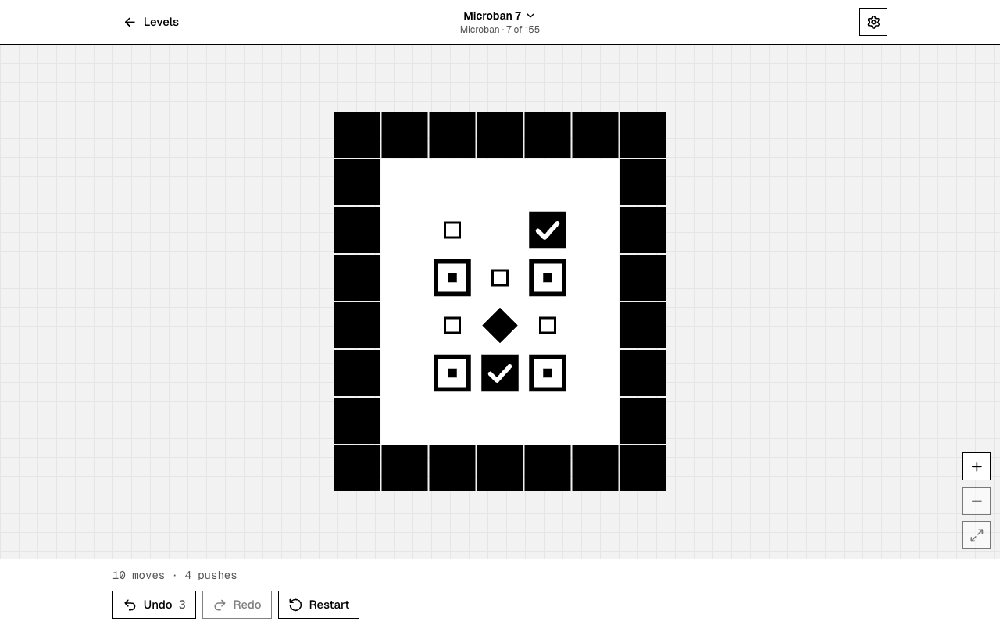
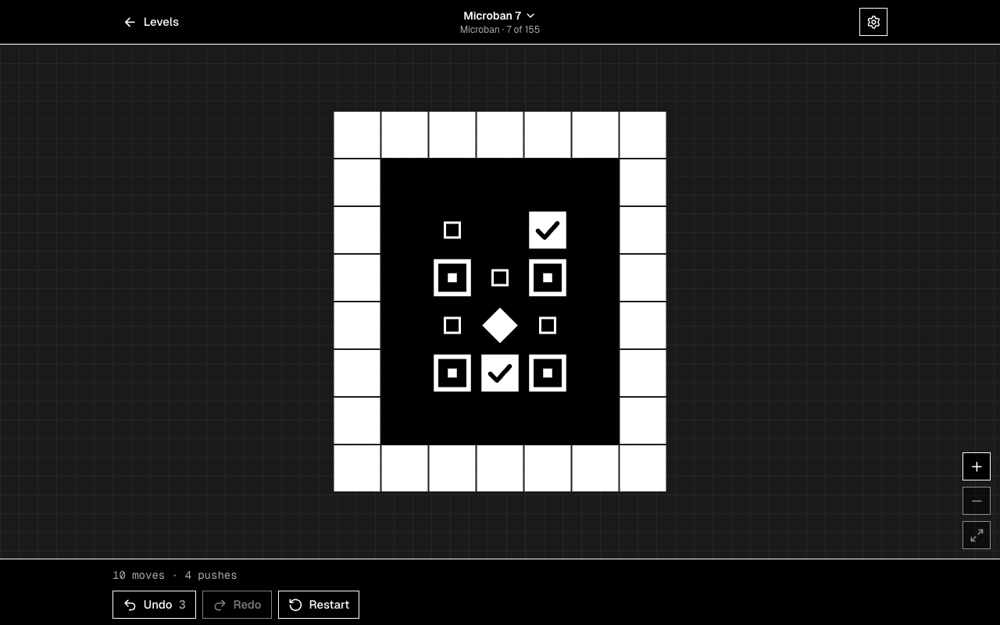
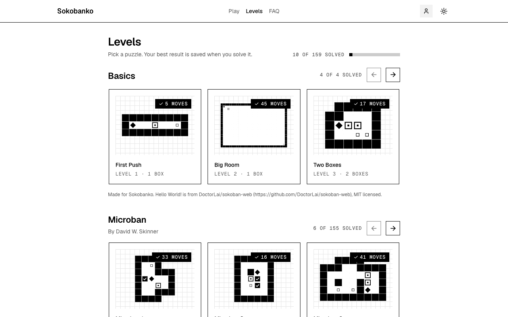
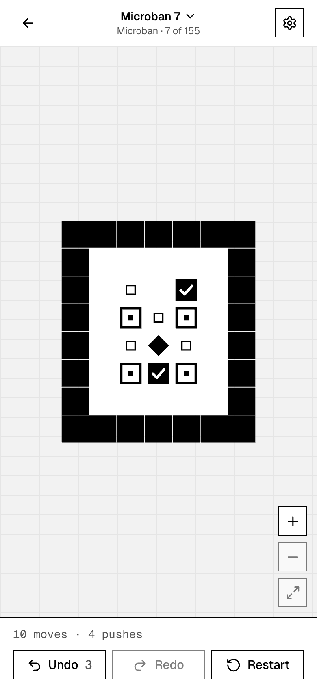

# Sokobanko

The classic box-pushing puzzle in the browser, with server-verified results and no sign-up.

**[Play it at sokobanko.app →](https://sokobanko.app)**

| The play screen, light and dark | |
| --- | --- |
|  |  |
| **The Levels page** | **On a phone** |
|  |  |

## What it is

Sokoban is a 1982 puzzle: push every box onto a goal, without ever pulling one. Sokobanko brings it to any browser, on a phone or a computer:

- **159 levels:** four to learn the rules, then David W. Skinner's Microban, all 155.
- **Play straight away.** No account. Your progress is kept even when you're offline.
- **Fair scores:** every move and push is counted, each attempt gets three undos, and the server checks each result before keeping it.
- **Made for everyone:** touch or keyboard, light and dark, screen-reader announcements, and a monochrome board that tells pieces apart by shape, not colour.

## Engineering highlights

- **One set of rules, two places.** The game logic is a pure, dependency-free TypeScript package. The browser plays with it, and the server replays every result with it. ([Architecture](https://github.com/vindotski/sokobanko/wiki/Architecture))
- **Results that can't be faked.** The browser sends a run's whole input log, undos included. The server replays it, enforces the undo budget and the unlock order, and keeps a best only if it really solves the level.
- **Local first.** A solve counts immediately and unlocks the next level offline too. Progress syncs in play order once the server can be reached, and a run the server refuses is dropped.
- **A real game canvas.** PixiJS v8, with a map-style camera (pinch, scroll, fit, recenter), a floating joystick, deadlock warnings and accessible announcements.
- **Data with guarantees.** Postgres through Drizzle. Integrity constraints protect players' results, and the migrations carry the levels themselves.
- **Shipping:**
  - CI checks every pull request: branch names, lint, strict typecheck, unit and database tests, and the build.
  - Images are multi-arch and distroless, with an SBOM and provenance.
  - Releases are signed version tags that deploy with zero downtime to [Spotcraft](https://spotcraft.dev), the self-hosted platform the author also built.

**Stack:** Nuxt 4 · Vue 3 · TypeScript · PixiJS v8 · Pinia · Tailwind CSS v4 · shadcn-vue · Postgres · Drizzle · Vitest · Biome · Docker · GitHub Actions · Spotcraft

## Documentation

- **[The wiki](https://github.com/vindotski/sokobanko/wiki):**
  - [Architecture](https://github.com/vindotski/sokobanko/wiki/Architecture)
  - [Getting Started](https://github.com/vindotski/sokobanko/wiki/Getting-Started)
  - [Development](https://github.com/vindotski/sokobanko/wiki/Development)
  - [Deploying on Spotcraft](https://github.com/vindotski/sokobanko/wiki/Deploying-on-Spotcraft)
  - [Self-Hosting](https://github.com/vindotski/sokobanko/wiki/Self-Hosting)
- **[Contributing](CONTRIBUTING.md):** branches, pull requests and releases.
- **[Changelog](CHANGELOG.md):** what changed in each version.

## Author

[Ivan Vinski](https://www.vin.ski) · [ivan@vin.ski](mailto:ivan@vin.ski)

## License

Copyright © Ivan Vinski. The code is licensed under the [GNU Affero General Public License v3.0 only](LICENSE) (AGPL-3.0-only). In short, anyone who runs a modified version as a public site must offer its source to the site's users. Versions released before this change remain available under MIT.

The levels keep their own terms. The Hello World! level is from [DoctorLai/sokoban-web](https://github.com/DoctorLai/sokoban-web), MIT licensed. The Microban levels are by David W. Skinner, from [his Sokoban page](https://web.archive.org/web/2010/http://users.bentonrea.com/~sasquatch/sokoban/): his sets "may be freely distributed provided they remain properly credited".
